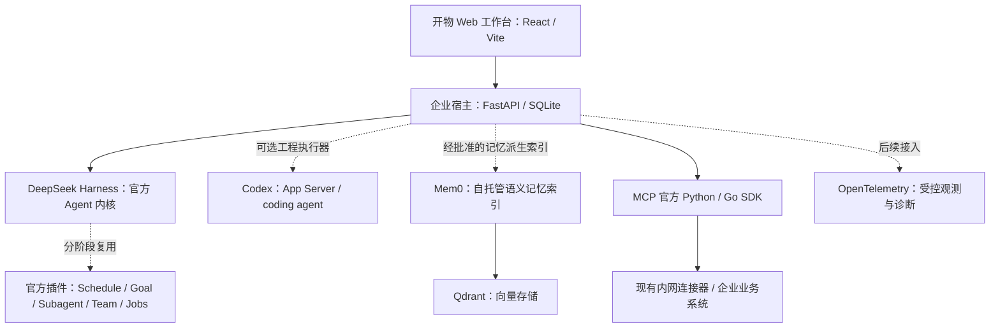
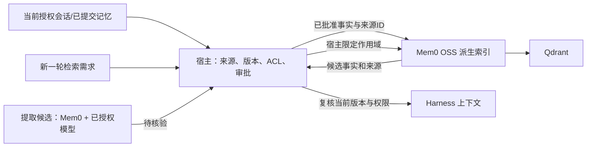

# 开物（Flint）开源技术底座与复用清单

**维护日期：2026-11-25｜适用范围：开物工作台、Agent Harness、企业连接器及后续对标开发**

本文件是项目统一的开源选型与采用记录。开发任何通用模块前，先从已采用框架和上游官方组件中找可复用实现；优先直接依赖、官方插件或薄适配器，最后才自研。不能把安装、源码存在、隔离验证、生产启用混为一谈。

基线：本次检查时生产工作台为 320e9d7，仓库主线为 e48166f。官方 Harness 固定源码为 fcc0ad462172522aaf5c93a7b2e01f6b9f0b0159（0.2.2-rc.1）。原有系统已承载企业业务，不通过替换整个框架来追求开源比例。

## 1. 总体架构与职责边界



虚线表示选定但仍待生产集成，不是已经上线。企业宿主是用户、会话、权限、业务操作、审计、调度执行回执和记忆版本的唯一权威；开源内核负责通用 Agent 能力，不能让模型或第三方插件自行扩大权限。部署仍保持客户内网和开物公网的隔离。

## 2. 已采用或已有实现的开源资产

下列版本来自仓库清单、固定源码、现有测试环境或连接器第三方声明。状态特意区分：**运行中**（有生产证据）、**已实现**（有代码或构建/验收记录但不能据此判断每个客户均启用）、**声明依赖**（清单声明，需部署版本核对）。许可证是直接包上游声明或安装元数据，不等于完成全传递依赖、模型权重和商业许可审计。

| 模块 | 开源组件及固定版本/来源 | 许可 | 当前状态与用法 |
|---|---|---|---|
| Agent 主执行器 | [DeepSeek Harness](https://github.com/deepseek-ai/deepseek-harness/tree/fcc0ad462172522aaf5c93a7b2e01f6b9f0b0159) | MIT | 运行中；真正运行官方 Node 内核及 Python SDK，不是只模仿 UI。server/harness/profile.py 明确选择官方 agent、agent-loop、session、LLM、工具、JSONL、重试、附件等模块 |
| 旧会话兼容 | claude-agent-sdk 0.2.178 | SDK 元数据 MIT | 声明依赖、旧执行器兼容；不将底层商业服务、Claude Code 分发或模型计费视为开源 |
| Web API | FastAPI 0.162.0、Uvicorn 0.54.0、Pydantic 2.14.2、HTTPX 0.28.1 | MIT / BSD-3-Clause / MIT / BSD-3-Clause | 已实现；版本见 server/pyproject.toml |
| 持久存储 | SQLite / Python sqlite3 | SQLite public domain | 运行中；会话、队列、授权、反馈和结果记录。保留一套权威状态 |
| Web UI | React / React DOM 18.3.1；TypeScript 5.7.3；Vite 6.1.0 | MIT / Apache-2.0 / MIT | 运行中；自有业务工作台，client/package-lock.json 固定依赖 |
| Markdown、图标 | react-markdown 9.0.1；remark-gfm 4.0.0；lucide-react 0.468.0 | MIT / MIT / ISC | 已实现；不自研 Markdown 渲染器与图标库 |
| 工作流画布 | [FlowGram](https://github.com/bytedance/flowgram.ai) @flowgram.ai/free-layout-editor 1.0.16 | MIT | 已实现并有历史隔离验收；沿用原工作流数据模型，功能开关控制。不能将画布采用等同于整个工作流引擎已替换 |
| MCP 协议 | [官方 Python SDK](https://github.com/modelcontextprotocol/python-sdk) mcp 1.30.0；[Go SDK](https://github.com/modelcontextprotocol/go-sdk) v1.8.0 | Python 安装元数据 MIT；Go SDK 原许可文件含 Apache-2.0 / MIT 过渡及文档 CC-BY-4.0 | 运行中；复用协议、流式 HTTP、工具发现与调用，不手写完整 MCP 协议 |
| 内网连接 | Go；coder/websocket v1.8.15；golang.org/x/oauth2 v0.35.0 等 | Go/BSD、websocket ISC、各包原 LICENSE | 已实现；原生出站中继保持。详见 connector/go.mod、connector/third_party/README.md |
| 旧 FRP 连接方案 | [fatedier/frp](https://github.com/fatedier/frp) 0.61.1 | Apache-2.0 | 旧兼容交付使用；不是华微当前原生连接器的必需运行组件，不恢复被客户拦截的 FRP 链路 |
| 参数约束与密码/密钥 | jsonschema 4.26.0、referencing 0.37.0、cryptography 50.0.2 | MIT / MIT / Apache-2.0 OR BSD-3-Clause | 已实现；复用标准校验及加密库，业务权限规则保留在宿主 |
| 文档解析、渲染 | pypdf 6.21.4、pypdfium2 5.14.0、Pillow 12.3.0（本地安装版本） | BSD-3-Clause / BSD-3-Clause、Apache-2.0 及 PDFium 第三方许可 / MIT-CMU | 已实现；截图、PDF、附件解析。Pillow 作为运行时依赖，仍需核对直接依赖/锁定声明 |
| OCR、检索嵌入 | rapidocr-onnxruntime 1.4.4、[FastEmbed](https://github.com/qdrant/fastembed) 0.9.1 | Apache-2.0 | 已实现；现有知识库另有显式 BM25/词法回退路径。具体模型启用状态及权重许可另核验 |
| 测试 | pytest 8.4.2、Vitest 3.0.5 | MIT | 已使用；真实 Harness、FastMCP、浏览器回归作为验收基线 |

完整直接依赖以 server/pyproject.toml、client/package.json、client/package-lock.json、connector/go.mod、Go 合规清单为准。当前不是正式全依赖 SBOM；服务器 WebSocket 等声明依赖与各环境实际安装版本需要发布时逐项对账。

## 3. 未来对标模块的首选开源实现（已选定，按验收推进）

DeepSeek Harness 采用插件组合架构，固定源码中已经包含下面的 Schedule、Goal、Subagent、Team 等能力，不需要先升级到不稳定最新版才开始复用。原则上优先集成现有固定版本；若缺失所需功能，单独评估上游升级，绝不直接覆盖生产源码。

| 功能 | 首选及复用方式 | 当前采用状态 | 开物需要保留/适配的边界 |
|---|---|---|---|
| 调度规则 | 官方 packages/schedule/schedule/src/domain.ts 与 packages/util/time，直接调用其 cron / RFC 5545 RRULE 规则计算 | **原始源码直接调用已验证；高级规则已完成候选集成**，见 §4 | 现有 SQLite/FIFO 负责持久任务、用户隔离、运行回执、防重复；不得把单次 inbox 投递成功当业务执行成功 |
| 全局定时任务、自然语言自动化 | 官方 dsh-schedule、dsh-tool-schedule、packages/client/ui-schedule 的协议与交互；优先兼容接口与实现复用 | 会话暂停/恢复、全局中心、编辑、立即运行及自然语言创建/查询/修改已隔离通过；自然语言创建/修改与拒绝审批真实浏览器验收通过；生产精确基线与整包发布待完成 | 原生 Host 任务管理跨整个 Host，不能向多租户模型直接暴露；用户绑定由宿主推导，创建/改周期需明确授权 |
| 持久 Goal | dsh-goal、dsh-goal-round-driver、dsh-tool-goal、command-goal | 原生状态、工作台及默认关闭的执行授权/预算/租约 97/97 组合隔离通过（[验收](../evidence/KAIWU_GOAL_DRIVER_PILOT_2026-11-25.md)）；官方自动 driver 下游许可 seam 5/5 隔离通过（[验收](../evidence/KAIWU_GOAL_NATIVE_DRIVER_SEAM_2026-11-26.md)），尚未挂载产品，真实费用与单轮硬预算未解决 | 一目标一会话；目标完成条件、轮次/成本上限、人工暂停、审批与恢复。官方持久目标不等于进程重启后自动获准继续 |
| 持久子智能体与通信 | dsh-subagent、subagent-spawn-in-process、subagent-fork-in-process、tool-subagent、tool-subagent-control | 已选定，待接入 | 本地 spawn/fork 才是当前上游可继续会话；外部 ACP/DSH SDK/Codex/Claude Code provider 在该固定版本是一次性执行。保留现有子任务能力直到迁移通过 |
| 团队及 DAG | dsh-agent-team、dsh-tool-agent-team、ui-agent-team | 官方基线及只读投影 8/8 通过（[接线](../evidence/KAIWU_TEAM_STATE_SEAM_2026-11-26.md)）；默认关闭的只读产品 API 与 Goal/profile 组合 74/74 通过（[产品 API 验收](../evidence/KAIWU_TEAM_PRODUCT_READ_2026-11-26.md)），UI 浏览器验收待做，不启用执行工具或 provider | 共用任务板、依赖和 CAS 认领直接复用，企业账号/项目/权限、资源隔离及 L1/L2/L3 角色控制由宿主补齐。上游任务板不是跨进程分布式调度器 |
| Codex 编码执行器 | [openai/codex](https://github.com/openai/codex) 开源 CLI / [App Server](https://github.com/openai/codex/tree/main/codex-rs/app-server) | Apache-2.0，上游发行来源与实际二进制许可待复核 | 本地 0.165.0 固定 SHA-256、官方 CLI 生成 schema 通过（[基线](../evidence/KAIWU_CODEX_APPSERVER_SCHEMA_2026-11-26.md)），无外网真实 stdio/线程元数据 4/4 通过（[验收](../evidence/KAIWU_CODEX_APPSERVER_STDIO_2026-11-26.md)）；作为可选工程执行器；优先 App Server 的线程、事件、审批和恢复接口，不通过终端文本猜测状态。Codex 桌面端/云服务并非全部开源 |
| 长期记忆 | [Mem0 OSS](https://github.com/mem0ai/mem0) 2.2.1、[Qdrant client](https://github.com/qdrant/qdrant-client) 1.20.0（pilot） | **真实 SDK 隔离验证通过**，均 Apache-2.0 | 见 §5；默认关闭的适配器及宿主快照准入已通过组合 89/89 与真实 SDK 5/5（[验收](../evidence/KAIWU_MEM0_HOST_ADMISSION_2026-11-26.md)），另有默认关闭单宿主互斥及有界查询回退 7/7（[验收](../evidence/KAIWU_MEM0_SINGLE_WRITER_2026-11-26.md)）；逐次准入及撤权回滚 43/43 后端、6/6 真实 SDK 通过（[验收](../evidence/KAIWU_MEM0_SYNC_REVOCATION_2026-11-26.md)）；未接产品调用路径。Mem0 为语义索引及记忆提取候选，不替代现有权威记忆、审批或用户身份 |
| 终端与后台任务 | dsh-terminal、dsh-terminal-bash、dsh-jobs、dsh-jobs-local、dsh-tool-jobs；如原 UI 不能嵌入，评估 xterm.js (MIT) | 已选定，待隔离验证 | 官方 terminal/jobs-local 是进程本地能力；若要跨进程持续，需可持久执行器和恢复协议，不能声称现成支持 |
| 浏览器/计算机操作 | dsh-browser-use、dsh-computer-use 的 provider seam；可复用现成受控浏览器/桌面 provider | 待选定实际 provider、隔离与许可复核 | 用户授权、租户独立环境、网络出站和文件边界；注册 seam 本身不包含操作驱动 |
| Sandbox / 文件环境 | 官方 sandbox、sandbox-local、sandbox-policy、fs、subprocess 与 SSH provider | 已选定，待部署验证 | 不将同内核本机读写限制当强租户隔离；禁止直接把客户/宿主整机挂给 Agent |
| 反馈和观测 | dsh-message-feedback、command-feedback、telemetry；[OpenTelemetry Collector](https://github.com/open-telemetry/opentelemetry-collector) (Apache-2.0) | 现有反馈已上线；本人回执/历史/状态及管理员处理说明隔离通过（见 [历史验收](../evidence/KAIWU_FEEDBACK_TRACKING_2026-11-25.md)、[处理说明验收](../evidence/KAIWU_FEEDBACK_RESOLUTION_2026-11-25.md)）；逐回答快捷入口隔离通过（[验收](../evidence/KAIWU_FEEDBACK_MESSAGE_2026-11-25.md)）；站内处理结果通知隔离通过（[验收](../evidence/KAIWU_FEEDBACK_NOTIFICATIONS_2026-11-25.md)）；受控遥测待接入 | 开物反馈编号、会话/轮次关联、管理员处理状态保留。默认不向上游/外部发送反馈、截图、业务正文或完整会话 |
| 知识检索 | 继续 FastEmbed/现有文件及证据链；Qdrant 服务器作为大规模向量检索候选 | 现有实现，Qdrant 服务器未部署 | 不与 Mem0 混淆：知识库是有来源的企业知识；记忆是用户/任务历史。先压测再决定迁移 |
| UI 体验 | 优先复用上游 ui-schedule/ui-goal/ui-subagent/ui-agent-team/ui-commands/ui-reference/ui-jobs 等插件；如 Cordis 组合与开物 React/API 不兼容，使用官方公开协议及交互契约薄适配 | 待兼容性验证 | 不为了复用而替换整个工作台、破坏会话 URL 或丢失企业功能 |

官方源码按固定提交定位，例如 [schedule](https://github.com/deepseek-ai/deepseek-harness/tree/fcc0ad462172522aaf5c93a7b2e01f6b9f0b0159/packages/schedule)、[goal](https://github.com/deepseek-ai/deepseek-harness/tree/fcc0ad462172522aaf5c93a7b2e01f6b9f0b0159/packages/goal)、[subagent](https://github.com/deepseek-ai/deepseek-harness/tree/fcc0ad462172522aaf5c93a7b2e01f6b9f0b0159/packages/subagent)、[team](https://github.com/deepseek-ai/deepseek-harness/tree/fcc0ad462172522aaf5c93a7b2e01f6b9f0b0159/packages/team)。优先评估这些模块，而非同时引入 LangGraph、CrewAI、AutoGen 等重叠的通用编排内核。除非现有官方插件无法满足验收条件且有证据，否则不叠加第二套 Agent runtime。

## 4. 本轮真实复用验证：DeepSeek Harness 时间规则

通过 scripts/oss/harness_schedule_probe.mts 直接加载已固定的上游 Schedule domain。验证前检查 Git commit 和 tracked diff；复用现有 Node 24.9.0 / tsx 及官方 tsconfig 路径解析，不复制或重写时间算法。

| 测试 | 结果 |
|---|---|
| 工作日 Cron 首次/下一次与错过周期 | 通过 |
| 周末跳过 | 通过 |
| 非法 Cron 和时区 | 通过 |
| 每月 RFC 5545 RRULE 与有限次数结束 | 通过 |
| 秒级频率非法规则 | 通过 |
| 夏令时跳过/重叠 | 通过 |

命令：

```bash
SOURCE=/media/data3/dengkw/projects/open-claude-code/.runtime/third_party/deepseek-harness
NODE=/media/data3/dengkw/projects/open-claude-code/.runtime/harness-toolchain/node-v24.9.0-linux-x64/bin/node
TSX_TSCONFIG_PATH="$SOURCE/tsconfig.json" "$NODE" \\
  --import "$SOURCE/node_modules/tsx/dist/esm/index.mjs" \\
  scripts/oss/harness_schedule_probe.mts "$SOURCE"
```

本阶段选定的集成方式：**复用官方规则计算 + 现有企业调度执行边界**，而不是并行开启一个官方 Host scheduler。原因：上游公开说明 inbox delivery 回执并非执行历史，也不承诺严格 exactly-once；目前开物已经有带唯一运行键的持久消息队列和实际业务运行回执。引入两套派发器会造成重复任务和权限分裂。下一步将规则适配器、全局管理 API 和自然语言管理工具接到现有队列，维护原有一次、每日、每周计划的兼容性。本轮高级规则已在独立候选版本通过 API、持久队列及前端验证；随后周期暂停/安全恢复复用原规则和队列，通过 18 项后端及 6 项前端组件测试，详见 [生命周期验收](../evidence/KAIWU_SCHEDULE_LIFECYCLE_2026-11-25.md)。尚未生产启用。恢复、回退与管理接入以 docs/plans/KAIWU_PARITY_EXECUTION.md 为准。

## 5. Mem0 接入设计与验证

### 5.1 选型

Mem0 开源 SDK 2.2.1（GitHub release v2.2.1，2026-09-25，短 commit 94c3fe9）；采用 self-hosted Python Memory 类，不用 Mem0 Platform / MemoryClient，也不需要 Mem0 SaaS API Key。轮子哈希已与 [PyPI 发布](https://pypi.org/project/mem0ai/2.2.1/) 核验：SHA-256 fe91bb91ac8926231993a4aa58df00a60c6c74c709e6a338fe399500776eef4d。开源部分采用 Apache-2.0。

选择理由：已有成熟的记忆提取、去重、检索和向量后端接口；开物的 Python 服务兼容，能配置模型和 embedding 供应商。Mem0 的云平台 benchmark 含专有优化，不能拿公开云端成绩冒充本地开源部署效果；SDK 2.2.1 部分 temporal 参数也明确属于平台能力。

### 5.2 目标架构



1. NativeMemory、Markdown 快照及 SQLite 的 revision/digest/原生代次继续作为权威；Mem0 不替换用户编辑/清空/审批界面。
2. 增加一个可选 Mem0 适配服务（独立依赖环境、明确配置模型和向量存储）。第一版仅对已批准、已提交的记忆事实建立派生索引，使用 infer=False；单独的提取候选管线可调用 infer=True，但未经人工确认的候选不能进入可检索的正式索引。提取临时库与正式库分离。
3. 所有作用域（用户、助手、会话、有效记忆代次）由宿主生成与校验，不接受模型提供任意 user_id/agent_id/run_id/filter。跨会话记忆共享默认关闭。索引结果必须绑定原文来源、当前 revision/digest；更新或清空后旧代次立即不可见，再异步清理派生数据。向量相似度不授予权限。
4. 禁止默认 OpenAI 外部端点、环境凭据泄漏和默认遥测（MEM0_TELEMETRY=false）；生产模型和 embedding 使用经批准的内网/租户线路，网络出站由宿主或容器策略限制。检索失败回退已有记忆机制，不把失败当作空记忆、不修改权威状态。
5. Mem0 历史 SQLite、向量、缓存和提取临时记录都纳入留存/删除、备份及租户隔离规则。SDK delete/delete_all 只能证明相应记录从检索消失，不等于日志、历史或备份已经被物理删除。

### 5.3 已通过的实际验收

在 VIP 的 data3 独立 pilot 环境安装 Mem0 2.2.1、Qdrant client 1.20.0 及锁定的依赖（scripts/oss/mem0-pilot-requirements.txt）。pip check 无依赖冲突。脚本 scripts/oss/mem0_probe.py 运行真实 Mem0 SDK、本地 Qdrant 持久库、回环地址的合成 OpenAI-compatible embedding 与 extraction HTTP provider，测试内拒绝非回环连接；关闭遥测。未读取生产数据库、未使用客户对话或真实模型密钥。

- 已批准事实写入。
- 多用户/多会话过滤：即便测试向量完全相同，检索不跨作用域。
- 无作用域查询被拒绝。
- 实际提取管线发出本地模型请求并保存合成事实。
- 重复提取不重复插入。
- 关闭并重新打开后数据保持。
- 目标作用域删除后无法检索，其它作用域不受影响。

**7 项通过，embedding 请求 9 次，提取请求 2 次，均为回环合成服务。** 本次未安装 spaCy 或 FastEmbed 扩展，因此未验证 BM25/实体增强和真实模型记忆质量。未启用正式 Mem0 记忆服务。

### 5.4 正式接入门槛

- 单元及隔离集成：跨租户/会话/代次过滤、删除后不复活、撤权、重建索引、故障回退、重复提交幂等。
- 真实模型对照：现有 NativeMemory vs NativeMemory+Mem0，用经授权的中文任务测试集、公开长期记忆 benchmark（如 LoCoMo、LongMemEval）和业务记忆中的时间变化、冲突、遗忘任务；明确 SDK 与托管平台区别。衡量召回、事实准确率、过期事实误用、延时、token 与成本，结果决定是否默认开启。
- 生产：版本及传递依赖审计、独立存储和出站控制、备份/清理、限流、开关、回退；先测试账号再客户授权，不在本次 pilot 直接迁移生产记忆。

### 2026-11-25 后续实际采用记录

- 官方 dsh-goal 状态服务已在隔离工作台实现真实持久状态及生命周期管理；不挂载自动 driver 或模型 Goal 工具。默认关闭功能，见 [Goal 接入](../evidence/KAIWU_GOAL_STATE_2026-11-25.md)。
- 固定官方 subagent/Team 的 12 套件 389/389 通过，见 [官方基线](../evidence/KAIWU_SUBAGENT_TEAM_UPSTREAM_2026-11-25.md)，仍需产品集成，不代表已上线。
- Mem0 派生索引适配由 VIP 独立 Claude Code 工人开发，真实 SDK 产品集成尚待验收。

- 2026-11-26：固定官方工作区、Jobs、终端、sandbox policy 与浏览器/计算机 provider registry 37 套件 737/737 通过，见 [工作环境基线](../evidence/KAIWU_WORKSPACE_UPSTREAM_2026-11-26.md)；尚未产品接入，不代表实际浏览器/桌面驱动或强租户隔离已验证。

## 6. 实施顺序与工作量控制

1. **任务管理**：优先以官方 Schedule/时间规则、自动化工具协议及 ui-schedule 的交互为基础，完善现有队列的管理生命周期；反馈处理回执/状态查询优先借鉴 message-feedback，保留已有企业工单。
2. **持续目标**：接入官方 Goal 的状态及 driver，再补预算、完成判定、暂停/恢复和运行回执对齐；不再另写完整循环执行框架。
3. **多智能体**：先官方 spawn/fork、消息及 Team，迁移目前一次性子任务方式；Codex 工程执行器独立做 App Server 验证。
4. **记忆**：Mem0 已完成第一轮 SDK pilot，可并行进入派生索引适配、真实模型及权限测试。不依赖更换主执行器。
5. **完整工作环境**：按官方 workspace/sandbox/terminal/jobs 与可用 browser/computer providers 验收，开放前先实现租户隔离和操作审批。按使用需求再引入 OpenTelemetry。

不以 Star 数作为唯一门槛，不为了追求开源而更换已有稳定模块。上游已经包含完整能力时优先直接用；上游与企业安全模型有差异时仅写必要适配；若必须自行开发，先记录无法复用的证据和成本比较。

## 7. 全部后续开发的强制规则

每个新需求/PR 要更新本文件或链接专项 ADR，说明：要解决的问题、搜索的现有上游模块与成熟替代项、选择理由、版本/commit/包完整性摘要、许可证及传递依赖、复用边界、自研范围、运行成本、真实验收结果、生产启用版本和回退方法。状态至少分为“候选”“已选”“隔离通过”“已合入”“已上线”“生产验收”；没有证据不得提前改状态。

禁止直接跟随 main/latest；优先复用已经固定且有测试的同一版本。构建锁定所有依赖及模型权重来源，生成/核对 SBOM，执行漏洞扫描和许可证/NOTICE 检查。专有模型 API、云服务、商业插件、带附加多租户/再分发条款的软件必须单独审查，不因为开源客户端就视为免费或可任意商业分发。已有 Coze Studio、Dify、n8n 等选型历史见 docs/design/ADR-20261107-workflow-builder-open-source-selection.md，新增采用前重新核对许可和维护情况。

优先选现成开源搜索、已有测试、现有部署资产、官方接口，代码量最小化不是放弃安全验证。企业差异化自研集中在权限、内网连接、业务证据、运维、客户体验与薄适配器。

## 8. 已知问题与记录

- 当前生产仍使用 320e9d7，本轮没有变更线上执行器、记忆、权限或客户数据。
- 固定 Harness 0.2.2-rc.1 是开发预览；上游明确有破坏性变更，不能仅凭开源/Star 数保证稳定，必须固定版本与回归测试。
- 第一次 Node 直接导入缺少 tsx 官方路径配置，设置 TSX_TSCONFIG_PATH 后六项通过；没有修改上游源码。
- VIP 系统根分区本轮检查约 23 MiB 可用（100%），data3 约 93 GiB 可用。Mem0 安装首次因系统没有 ensurepip，之后因 /tmp 空间不足失败。使用现有 pip 的 --python 指向独立无 pip venv，并将临时文件/缓存放到 data3 后成功；未改系统软件包、未清理其他项目。
- 本轮 pilot 证据位于 /media/data3/dengkw/acceptance/kaiwu-oss-reuse-20261125/；真实依赖版本记录和脚本进入仓库；尚需真实模型/生产验收。Qdrant 本地模式仅用于本次测试，不是生产多租户部署结论。

## 官方资料

- DeepSeek Harness: https://github.com/deepseek-ai/deepseek-harness ；许可 MIT，固定源码 LICENSE/THIRD_PARTY_NOTICES。
- Schedule 设计及限制: https://github.com/deepseek-ai/deepseek-harness/blob/master/docs/user/guide/schedule.md
- Team: https://github.com/deepseek-ai/deepseek-harness/blob/master/packages/team/agent-team/README.md
- Codex 开源许可: https://github.com/openai/codex/blob/main/LICENSE
- Mem0 开源自托管: https://github.com/mem0ai/mem0/blob/main/docs/open-source/overview.mdx ；固定版本: https://github.com/mem0ai/mem0/releases/tag/v2.2.1
- Qdrant client local mode: https://github.com/qdrant/qdrant-client
- OpenTelemetry Collector: https://github.com/open-telemetry/opentelemetry-collector


### 2026-11-26 Mem0 复用记录

Mem0 2.2.1 原生接口派生索引默认关闭候选完成真实 SDK 100 份文件/代次替换/隔离验收 5/5，最新主线组合回归 76/76；详见 [验收记录](../evidence/KAIWU_MEM0_INDEX_ADAPTER_2026-11-25.md)。正式宿主接线、质量与生产验收仍待做。

固定 Mem0 2.2.1 / OpenAI 3.59.0 / Qdrant client 1.20.0 的本地派生索引 pilot 已补传输超时及禁止 SDK 自动重试；真实 SDK 8/8、宿主回归 50/50。仅验证本地 Qdrant 与显式 OpenAI-compatible provider，不是端到端硬预算、远端取消或生产接线。详见 [I/O 验收](../evidence/KAIWU_MEM0_PROVIDER_IO_2026-11-26.md)。

固定 Mem0 SDK 自有资源关闭、关闭后拒绝调用及本地 Qdrant 持久库重开已独立验收（53/53 后端、9/9 真实 SDK）；详见 [资源关闭验收](../evidence/KAIWU_MEM0_RESOURCE_CLOSE_2026-11-26.md)。未接正式产品生命周期。

固定 Mem0 SDK 已提交但宿主回执丢失的隔离对账验收（55/55 后端、10/10 真实 SDK）；未确认立即停止后续写入及旧代次删除，后续显式授权完整枚举补缺，不自动重放。详见 [未确认回执验收](../evidence/KAIWU_MEM0_UNCONFIRMED_WRITE_2026-11-26.md)。无持久队列或撤权删除权限。

固定 Mem0 SDK 当前已提交原生 clear 的宿主清理准入与完整空结果回读（57/57 后端、11/11 真实 SDK）；详见 [清理准入验收](../evidence/KAIWU_MEM0_CLEAR_ADMISSION_2026-11-26.md)。尚无撤权后删除专用授权、产品接线或物理删除保证。

固定 Mem0 2.2.1 / Qdrant 1.20.0 删除边界真实 SDK 5/5：Qdrant 归属字段投影无需正文，SDK delete 则读正文并保留 SQLite 历史；清空向量不是删除历史。详见 [删除边界验收](../evidence/KAIWU_MEM0_DELETE_BOUNDARY_2026-11-26.md)。正式接线前优先验证作用域独立存储及删除专用准入。

固定 SDK 每权威作用域独立 Qdrant/SQLite 存储的合成可行性真实 SDK 5/5；验证同用户不同会话、跨用户及关闭后目录隔离，非物理删除。见 [作用域存储验收](../evidence/KAIWU_MEM0_SCOPE_STORE_2026-11-26.md)。优先薄适配权威身份与资源生命周期，尚未产品接线。

固定 Mem0 2.2.1 / Qdrant 1.20.0 作用域独立存储的持久身份与终态退役拒绝重开通过后端 68/68、真实 SDK 4/4，复用既有 SDK 与 TrustedScope，仅新增宿主文件生命周期薄适配；详见 [持久绑定验收](../evidence/KAIWU_MEM0_SCOPE_BINDING_2026-11-26.md)。正式删除授权、保留策略和产品接线待验收。

固定 Mem0 2.2.1 / Qdrant 1.20.0 逻辑退役准入复用既有原生清空回执与 SQLite 事务，后端 72/72、真实 SDK 隔离 6/6；详见 [退役准入验收](../evidence/KAIWU_MEM0_RETIREMENT_ADMISSION_2026-11-26.md)。不删除字节，正式删除许可、新代次与产品接线待验收。

Mem0 独立作用域可选宿主工厂复用既有 Mem0Host 与 ScopeStore，75/75 后端和真实 SDK/合成 authority 4/4；详见 [生命周期验收](../evidence/KAIWU_MEM0_SCOPED_HOST_2026-11-26.md)。无实际产品调用或生产启用。

D3 默认关闭的产品 API 已独立验收：复用 Mem0 2.2.1 adapter、Mem0Host、ScopeStore 和原权威 SQLite 快照，显式注入隔离工厂，不选默认供应方；产品及权限 40/40、最终分组回归 183/183。见 [D3 验收](../evidence/KAIWU_MEM0_PRODUCT_2026-11-26.md)。真实 SDK 与 Service 同进程、生产配置、UI 和质量/硬预算尚未验收。

固定 Codex CLI 0.165.0 的 App Server 已复用于当前工程轮的文本补充。宿主通过原生 turn/steer 校验线程及活动轮次，只处理权限、幂等和用户可读回执，保留独立停止后另问路径。隔离样本同一轮有 2 次模型收件，供应商费用未测。开发证据见[工程轮次补充条件](../evidence/KAIWU_ENGINEERING_TURN_STEER_2026-11-28.md)，生产仍沿原试点发布。

普通工程会话草稿沿用工作台按用户与会话分隔的键、退出清理和浏览器 IndexedDB 打开逻辑。新增本地草稿版本及提交编号快照，明确发送仍经原文本权限及幂等接口。没有新增依赖或模型计费动作。见[冷开、换账号与提交写盘故障证据](../evidence/KAIWU_ENGINEERING_UNSENT_DRAFT_2026-11-28.md)。

普通成员首次工程入口已复用原 Codex 工程确认窗、作用域草稿和固定 0.165.0 App Server。选择时只创建或打开会话，显式提交仍走既有文本接口。回环实测 1 次工程提交、1 个原生轮次和 1 次工程模型收件。入口与原生对照见[首次交付工程任务](../evidence/KAIWU_ENGINEERING_FIRST_ENTRY_2026-11-28.md)。

Goal 父会话继续复用固定 DeepSeek Harness 的原生父子运行、开物原有共享名额及经本人权限校验的运行回执。用户提问和父答读取同一份子任务快照；历史分页仅有已确认的混合结局父答时，再读它自己的快照。未引入执行服务。见[父会话部分成果验收](../evidence/KAIWU_GOAL_PARTIAL_RESULTS_2026-11-28.md)。

失败子项的续问沿用普通会话草稿和已有 Harness 分配入口。明确分配时只提交一个新子项，沿用当前成员和活动父轮的权限与资源限制。既有 Goal 授权保持结算状态。旧子号延续须由执行底层保存相应上下文；本次两端原生工具与开物的实际行为见[失败子项补做对照](../evidence/KAIWU_FAILED_CHILD_FOLLOWUP_2026-11-28.md)。
