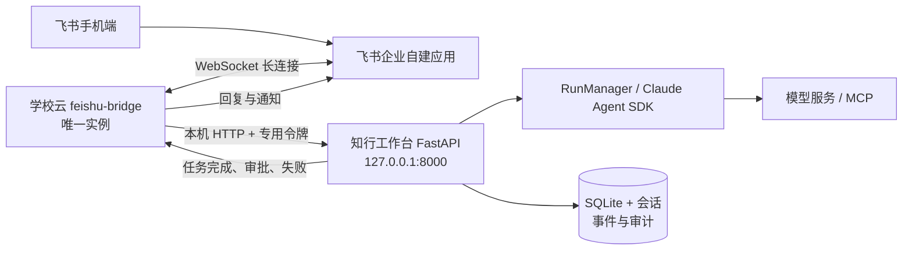

# 学校云智能体与飞书接入方案（第一阶段）

状态：可测试的第一阶段实现，尚未填入真实飞书应用凭据，也没有重启当前服务。

## 目标和边界

目标是让用户在飞书中直接发送任务、查看执行进度、收到最终答案，并能查询当前任务、停止任务和处理普通审批。学校云只需要保持向公网的出站连接；飞书事件不通过学校云的入站端口进入。

第一阶段复用本项目现有的 FastAPI、会话、运行记录和 Claude Agent SDK 执行层。飞书桥接进程是独立进程，负责飞书长连接和消息发送；服务端仍然是任务、权限、会话和审计的唯一事实来源。

Codex 命令行和已有 Orca 会话暂不通过飞书直接注入任务。Codex 的 `app-server` 接口在当前本机版本中仍标记为 experimental，后续应在独立适配器中固定版本、工作区和权限，再接入同一套网关。这样不会把未经稳定验证的终端控制协议混入第一阶段的生产任务链路。

## 为什么学校云不需要公网回调

飞书开放平台提供“使用长连接接收事件”方式。飞书官方说明：企业自建应用可以由服务器上的 SDK 主动建立 WebSocket 全双工连接，不需要公网 IP、域名或内网穿透；服务器只需能够访问公网。该方式还由 SDK 封装建连鉴权和事件加密处理。事件处理仍必须在三秒内返回，否则会触发重推；同一个应用多实例连接是集群模式，不能依靠广播接收同一事件。

因此部署时只运行一个 `feishu-bridge` 实例。Easy Connect 负责学校云访问受保护的校内资源；飞书链路使用出站 HTTPS/WebSocket。如果学校网络策略要求 Easy Connect 或代理才能访问公网，桥接进程继承该网络路径并在启动前做连通性检查。若学校网络完全禁止 WebSocket 出站，备用方案才是公网中继或一台具备 HTTPS 域名的跳板机。

## 组件



桥接进程不读数据库、不读工作区、不执行 shell。它只调用以下本机网关：

* `POST /internal/feishu/messages`：校验飞书账号和会话绑定，创建或复用会话，使用飞书事件编号作为幂等键提交任务。
* `GET /internal/feishu/runs/{run_id}/events`：读取脱敏后的运行状态、事件和最终助手消息。
* `GET /internal/feishu/status`：查询当前账号执行中的任务。
* `POST /internal/feishu/runs/{run_id}/cancel`：停止任务。
* `POST /internal/feishu/approvals/{approval_id}/decision`：处理普通单人审批；双人高风险审批仍要求在工作台完成。

网关只允许本机来源和独立高熵令牌。服务端按 `open_id` 白名单和固定工作台账号映射用户，飞书消息不能自行提交任意用户、助手、会话或工作区编号。

## 飞书后台配置

1. 创建“企业自建应用”，开启机器人能力。
2. 在事件订阅中选择“使用长连接接收事件”。不要在学校云上配置入站回调地址。
3. 订阅“接收消息”事件 `im.message.receive_v1`。第一阶段只处理文本消息；群聊需要额外显式加入聊天白名单。
4. 为应用申请发送和回复消息所需权限，并发布应用。发送与回复消息使用 `tenant_access_token`。
5. 保存应用的 `App ID` 和 `App Secret` 到学校云的权限受控环境文件，不提交到 Git。

官方入口：

* [事件订阅总览](https://open.feishu.cn/document/uAjLw4CM/ukTMukTMukTM/event-subscription-guide/event-subscriptions)
* [使用长连接接收事件](https://open.feishu.cn/document/ukTMukTMukTM/uYDNxYjL2QTM24iN0EjN/event-subscription-configure-)
* [Python SDK 处理事件](https://open.feishu.cn/document/server-side-sdk/python--sdk/handle-events)
* [消息概述与发送／回复接口](https://open.feishu.cn/document/uAjLw4CM/ukTMukTMukTM/reference/im-v1)

## 学校云配置

先在工作台网页中创建并确认一个可用助手，记下助手编号和要绑定的工作台账号。然后生成桥接令牌：

```bash
umask 077
install -d -m 700 /media/data3/dengkw/projects/open-claude-code/.runtime/feishu
python3 - <<'PY' > /media/data3/dengkw/projects/open-claude-code/.runtime/feishu/bridge.token
import secrets
print(secrets.token_urlsafe(48))
PY
chmod 600 /media/data3/dengkw/projects/open-claude-code/.runtime/feishu/bridge.token
```

服务端环境至少需要：

```bash
AGENT_FEISHU_BRIDGE_TOKEN_FILE=/media/data3/dengkw/projects/open-claude-code/.runtime/feishu/bridge.token
AGENT_FEISHU_USERNAME=你的工作台账号
AGENT_FEISHU_ASSISTANT_ID=已确认的助手编号
AGENT_FEISHU_ALLOWED_OPEN_IDS=你的飞书 open_id
```

桥接进程环境至少需要：

```bash
FEISHU_APP_ID=cli_xxx              # 邓凯文 BOT 的应用凭据
FEISHU_APP_SECRET=仅保存在权限受控文件中的 BOT 密钥
AGENT_API_BASE=http://127.0.0.1:8000
AGENT_FEISHU_BRIDGE_TOKEN_FILE=/media/data3/dengkw/projects/open-claude-code/.runtime/feishu/bridge.token
```

安装依赖并做配置检查：

```bash
python3 -m venv .runtime/feishu-venv
.runtime/feishu-venv/bin/pip install -r feishu_bridge/requirements.txt
PYTHONPATH=. .runtime/feishu-venv/bin/python -m feishu_bridge
```

正式部署应让服务管理器启动桥接进程，使用 `Restart=always` 和单实例锁；不要在多个终端、多个容器或多个副本中同时启动同一个 Feishu App 的长连接客户端。示例 unit 在 `feishu_bridge/zhixing-feishu.service.example`。

## 手机端命令

* 直接发送文字：创建任务。
* `/status`：查看执行中的任务。
* `/stop [任务编号]`：停止指定任务；省略编号时尝试停止当前聊天唯一任务。
* `/approve 审批编号` 或 `/deny 审批编号`：处理普通审批。
* `/help`：显示帮助。

桥接会在任务接收、关键阶段、需要审批、完成或失败时发送消息。模型增量正文不逐字推送，避免飞书消息风暴；最终答案一次性发送，并按长度分段。

## 稳定性和故障处理

* **重复消息**：服务端保存 `feishu_inbound_events`，飞书事件编号同时作为任务幂等键；重连或重推不会重复执行。
* **桥接重启**：任务状态仍在服务端 SQLite 中；桥接重新收到新消息后可重新查询任务。生产版应继续把 watcher 游标持久化到独立运行目录，避免仅依赖内存进度提示。
* **飞书断线**：SDK 自动重连，外层进程对启动失败使用指数退避；任务本身不会因为通知断线而取消。
* **服务端重启**：现有 RunManager 的恢复策略会把未完成任务标记为中断且不自动重放；飞书会收到中断状态，用户可重新发送任务。
* **学校网络断开**：Easy Connect 或代理恢复后，桥接重新建连；本机网关始终只绑定回环地址。
* **权限变化**：助手、连接、用户停用仍由现有服务端在每轮和工具审批时校验；飞书只是另一种入口。
* **双人高风险审批**：飞书入口默认拒绝直接处理，防止手机单人操作绕过双人策略；这类审批在工作台使用现有管理员队列。

## 验收顺序

1. 用假事件运行桥接解析和网关测试，不填真实密钥。
2. 在学校云确认 `https://open.feishu.cn` 的 HTTPS 和 WebSocket 出站路径；必要时先启动 Easy Connect。
3. 启动服务端新版本和一个桥接实例，开发者后台看到长连接在线后再保存订阅方式。
4. 从飞书单聊发送“回复一段测试文字”，验证任务只执行一次、最终答案可见、网页端能看到同一会话。
5. 验证 `/status`、`/stop`、普通审批和服务端重启后的中断提示。
6. 连续运行一小时，检查桥接日志、服务端事件、飞书重复消息和断线重连；通过后再交给 systemd 常驻。

## 当前未完成的工作

真实飞书 App ID、App Secret、`open_id`、助手编号和学校云 Easy Connect 的实际服务单元尚未提供，因此当前代码没有启动真实长连接，也没有重启正在运行的服务。Codex app-server 适配器、文件附件上传、飞书卡片原地更新和桥接游标持久化属于第二阶段。
