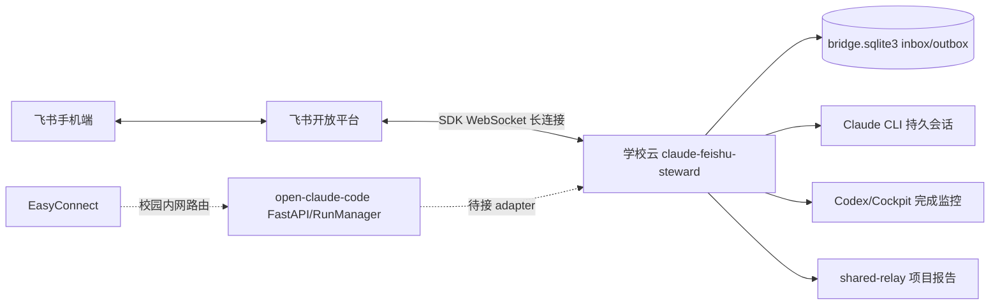

# 邓凯文-bot 现状审计与优化方案

状态：审计、最小实现与生产切换前检查，2026-11-07；生产 current 尚未切换。

本文基于本地 `open-claude-code` 仓库、EasyConnect 已连接时对学校云的检查，以及学校云上现有 `claude-feishu-steward` 部署快照整理。本轮只在 staged release 和隔离 FastAPI 副本上验证；没有切换 `current`、没有重启生产服务、没有把密钥写入仓库或日志。

## 结论先行

学校云上已经有一套可用的飞书边缘服务，不应在本地仓库再造第二套 Feishu WebSocket/消息发送器。现有桥已经承担了飞书接入、单人身份绑定、SQLite inbox/outbox、消息去重、失败重试、引用路由、Claude CLI 执行、Codex/Cockpit 完成通知和 watchdog。

下一步按这个顺序做：

1. 先修复现有桥的 SQLite 并发锁问题，并补齐 `tenant_key` 绑定与密钥权限检查。
2. 保留现有桥作为唯一 Feishu edge，把 `open-claude-code` 作为一个后端 adapter 接入；不要复制 Feishu token、WSS、outbox 或重试逻辑。
3. 用统一的 `job_id/run_id` 关联 Feishu 消息、学校云 Claude/Codex 任务和本地工作台运行记录。
4. 稳定后再增加 `/status`、`/cancel`、审批和卡片；群聊与多用户放到后续阶段。

### 当前行为收敛（2026-11-07）

生产已部署 `dialog-state-20261107-163000`：`uncertain` 仍记录某一条未确认任务的历史，但不再写入 conversation-wide blocked 标记，也不再自动发送“请 `/recover`”的拦截回复。普通新消息继续进入 Claude，prompt 携带最近 worker/task 状态摘要；Claude 只处理本轮消息，不能自动重放旧任务。`/status` 和 `/recover` 保留为显式控制命令。

## 已确认的当前链路



学校云服务的 systemd 用户单元是：

- `claude-feishu-steward.service`：运行 `/media/data3/dengkw/.claude-steward/current/bridge.py`。
- `claude-feishu-steward-watchdog.service` 与 `.timer`：约每 20 秒检查一次。
- 当前 release 是 `completion-monitor-20261105-155333`，`current` 是指向该 release 的符号链接。

现有桥在 `serve()` 中注册 `register_p2_im_message_receive_v1`，因此当前产品边界是“单一 owner 的飞书私聊机器人”，不是群聊机器人。它把事件先写入 SQLite，再由 worker 异步驱动 Claude，不在飞书事件回调中等待模型结果。outbox 使用稳定的 `send_uuid`，重启时把未完成模型 turn 标成 `uncertain`，不会盲目重放外部操作。

本地仓库已经有稳定的运行语义，但没有 Feishu bridge 代码或依赖。可复用的接口是：

- `POST /api/v1/conversations/{id}/messages`：创建消息并返回 `run_id`。
- `GET /api/v1/runs/{id}`：读取运行状态。
- `GET /api/v1/runs/{id}/events`：按游标重放公开 SSE 事件。
- `POST /api/v1/runs/{id}/cancel`：取消运行。
- `POST /api/v1/approvals/{id}/decision`：处理工具审批。

这些 HTTP 路由目前使用浏览器 HttpOnly cookie，不能让 steward 保存浏览器 cookie 或模拟登录。接入时应增加只供本机 bridge 使用的内部 facade，使用独立随机服务令牌和请求签名，并在 core 内再次执行用户、会话、run、approval 的授权检查。

## 审计结果

### 已有能力

- Feishu 出站网络和 WSS 不是假配置：service.log 有 `feishu_ws_connected`，远端从学校云访问 Feishu HTTPS 域名成功；EasyConnect 在线时 `school-ssh` 可达。
- systemd 服务当前 active，watchdog 处于 waiting，服务使用单实例锁，避免两个消费者同时读同一个 Feishu 应用。
- SQLite schema 已有 `inbox`、`outbox`、`monitor_seen`、绑定和引用路由字段；`outbox.send_uuid` 唯一，消息重试不会因为重启生成新的业务消息 ID。
- 重启恢复策略是保守的：运行中的 inbox 会进入 `uncertain`，不会自动再次执行可能有副作用的 Claude turn。
- `shared_reports`、`project_reporting`、`stewardctl` 已覆盖学校云与腾讯/Codex/Cockpit 的完成通知和定向派发，当前 bot 实际上是“Claude 管家 + Codex/Cockpit 通知 + 跨云报告”的混合桥。

### 需要先修的缺口

| 优先级 | 证据 | 风险 | 处理方式 |
| --- | --- | --- | --- |
| P0 | service.log 曾出现 `sqlite3.OperationalError: database is locked`，涉及 outbound `BEGIN IMMEDIATE` | 事件已收到但 worker/发送可能延迟，形成 backlog 或假性离线 | 先收敛 SQLite 写入路径；见下方“锁修复” |
| P0 | staged `bridge --check` 报 `tenant_bound=false`；身份文件缺少 `tenant_key`（current 旧 release 仍会把 `ok` 报为 true） | 事件来源校验不完整，租户配置错误无法在启动时阻断 | 补齐真实 tenant_key，切换到 staged release 后强制校验；不把值写日志 |
| P0 | systemd 使用 `--permission-mode bypassPermissions` | 飞书消息可直接驱动高权限 CLI，误操作影响面大 | 保留 dedicated steward 的明确策略，但将高风险操作切到审批或受限 profile；至少把该决策写入部署策略并提供 kill switch |
| P1 | 当前 bridge 直接驱动 Claude CLI，未接本地 FastAPI/RunManager | 手机、电脑 Web 工作台不是同一条 conversation/run；状态和审批无法统一 | 建立 backend adapter 与 run/job 关联，不复制 Feishu 层 |
| P1 | 当前仅支持私聊；没有 `card.action.trigger`、群聊 @、明确 cancel/approval | 手机端可用，但无法安全完成复杂控制 | 先做文本命令，再做卡片；群聊增加白名单后再开 |
| P1 | 当前存在 1 个 blocked binding、3 个 user inbox uncertain、1 个 blocked、3 个 routing_rejected；project report 有 9 条 received backlog | 阻断状态和积压可能被误认为服务故障或被错误恢复 | 先提供只读诊断和逐项确认；禁止批量 `/recover` |
| P1 | 直接在 current release 上运行旧测试得到 73 项中 8 failures/17 errors | 当前结果不可作为绿灯基线，且会读取真实 Cockpit 状态 | 固定 release、隔离 fake monitor 和 root 后再跑回归；当前不宣称全绿 |
| P2 | monitor 轮询、报告派发和聊天 worker 共用一个进程 | 某一类慢 IO 会影响另一类消息的及时性 | 保持单一 Feishu consumer，但把 adapter poll、outbox sender、backend worker 做独立队列/预算 |

## P0：先做的稳定性补丁

### 1. SQLite 锁修复

现有 `busy_timeout=30000` 和 `synchronous=FULL` 是必要条件，但不能替代写入串行化。建议按以下顺序修改远端 release，并在隔离环境回归：

1. 让所有写事务通过一个 writer 队列或同一 worker 的短事务完成；`send_one()`、`enqueue()`、monitor/report poll 不要各自长时间持有 `BEGIN IMMEDIATE`。
2. 事务只做状态变更和 outbox claim；Feishu API、Claude CLI、relay HTTPS 都必须在事务外执行。
3. claim 时使用短事务：`pending -> sending`；成功或失败再开启第二个短事务更新结果。
4. 增加 `sqlite_lock_retries`、`sqlite_lock_failures`、事务耗时和 outbox age 指标；遇到锁重试时必须保留原业务 ID。
5. 保留 WAL/`synchronous=FULL`，并增加定期 checkpoint、备份和磁盘空间探针；不要用降低 durability 的方式掩盖锁问题。
6. 增加并发压力测试：同时 enqueue、claim、finish、recover、monitor_seen，验收条件是无重复 send UUID、无丢失状态、锁重试后最终可达。

在完成压力测试前，不要把“把 timeout 调大”当作修复，也不要批量执行 `/recover`。

### 2. tenant 与密钥门禁

启动检查必须要求 `app_id`、`app_secret`、`owner_open_id`、`tenant_key` 同时存在；tenant 缺失直接 `check=false`，systemd 不应继续提供消息服务。身份文件、auth settings、proxy 配置和 relay token 都应是 owner-only 权限。轮换密钥时先停旧 consumer，再启新 consumer，避免两个实例同时消费。

历史飞书聊天中曾出现过凭据形态的内容，因此应把凭据轮换作为运维动作单独完成；本文不复制具体值，也不在仓库中保存新密钥。

### 3. 权限模式

当前 `bypassPermissions` 是专用单人 steward 的显式配置，不应扩散到本地工作台或多用户路径。建议拆成两个 profile：

- `owner-steward`：仅绑定 owner、固定 workspace、允许的 `stewardctl` 和只读工作区；高风险写入/部署仍要求明确命令或审批。
- `open-claude-code`：走 FastAPI 的 assistant、tool grant、approval、workspace 隔离和 run cancel；不继承 CLI 的 bypass 权限。

## P1：接入本地 open-claude-code

目标是“一条 Feishu 通道，多种后端”，而不是“两个 bot”。建议在 steward 内部抽象：

```text
BackendAdapter
  submit(command, target, idempotency_key) -> job_id/run_id
  status(job_id) -> normalized_status
  events(job_id, after_cursor) -> events + next_cursor
  cancel(job_id) -> normalized_status
  decide(approval_id, decision) -> approval_status
  health() -> backend_health
```

`claude-feishu-steward` 继续唯一负责 Feishu WSS、身份、inbox/outbox、消息分块、发送重试、引用路由和 owner gate。`open-claude-code` adapter 只负责把上述调用映射到本机 core。

### 推荐的内部边界

学校云当前版本的 `open-claude-code` 已经有 `server/app/feishu.py` 和 `feishu_bridge/`，提供 loopback-only 的 `/internal/feishu/messages`、`/status`、`/runs/{id}/events`、`cancel` 和 `approval` 网关，并在数据库中持久化 `feishu_chat_bindings` 与 `feishu_inbound_events`。生产接入应以这套现有网关为基线，避免再挂第二个 `/internal/feishu` 路由或第二个 Feishu consumer。它使用 owner-only bridge token + loopback 校验；后续可在不改变路由契约的情况下增加 HMAC。

本地仓库本轮也实现了一套更细粒度的 HMAC facade（`server/app/feishu_internal.py`），用于本地 contract/安全回归；由于学校云当前 runtime 比本地多了 subagents 能力，这套本地 facade 没有直接覆盖到学校云。学校云 staged adapter 正在切换到已有 token gateway，验证通过后再接入现有 steward。

无论采用哪套内部 facade，监听都必须限制在 loopback 或 Unix socket；不用浏览器 cookie，不暴露到公网。每次请求包含：

- `request_id`：重试不改变业务语义。
- `idempotency_key`：由 `message_id` 派生，保证 Feishu 重投不创建第二个 run。
- `feishu_owner`：只作为映射输入，core 仍查本地 user 与资源权限。
- `conversation_id` / `run_id` / `approval_id`：只接受 opaque ID，服务端重新校验归属和状态。
- `timestamp`、签名和短时 nonce：防止 loopback 请求重放。

第一版可只提供：

```text
POST /internal/feishu/resolve-target
POST /internal/feishu/submit
GET  /internal/feishu/jobs/{run_id}
GET  /internal/feishu/jobs/{run_id}/events?after=<cursor>
POST /internal/feishu/jobs/{run_id}/cancel
POST /internal/feishu/approvals/{approval_id}/decision
GET  /internal/feishu/health
```

本地工作台已先落地 HMAC contract，学校云当前版本则已有 token gateway；两者都不接受浏览器 cookie。最终生产路径固定使用学校云已有 gateway 的稳定路由，旧 steward 只作为 Feishu edge 和 outbox，不复制工作台授权逻辑。学校云 staged adapter 已按这个 token gateway 完成客户端和契约测试，但尚未接入旧 steward Worker；直接接入前还需要持久 run 关联、轮询、终态去重和重启恢复。

当前 facade 合同还规定：`submit` 返回 HTTP 202，并同时返回顶层 `run_id`、`message_id`、`status` 与兼容的 `run`/`message` 对象；相同 conversation 下复用不同 payload 的 `idempotency_key` 返回 409。`resolve-target` 创建会话使用签名 `X-Agent-Request-Id` 或 body `idempotency_key`，写入 `feishu_internal_targets`，重试返回原 conversation。事件接口使用 `after` 游标和 `limit=1..100`，返回 `next_cursor`、`terminal`，并限制事件字段大小。终态 job 查询返回有长度上限的 `assistant_message.text` 与 `summary`，不依赖 token 事件才能发送最终结果。

这些 facade 应直接调用现有 `Service.prepare_run`、`RunManager.submit/cancel`、`Service.run_view`、`Service.public_events` 和 approval 逻辑，避免 HTTP 自调用造成额外 cookie、代理和连接池问题。外部 HTTP 形式只作为清晰的接口契约；实现可以是同进程 Python facade 或 Unix socket RPC。

### 目标选择与关联

不要依赖“当前最新会话”。建议把目标写进每条入站消息的 `target_json`：

```json
{
  "backend": "open-claude-code",
  "conversation_id": "opaque-conversation-id",
  "assistant_id": "opaque-assistant-id"
}
```

若没有显式目标，只允许使用已经持久化的 Feishu→conversation binding；没有 binding 时先回复选择目标，不启动模型。每条消息保存：

```text
feishu_message_id -> steward_inbox_id -> backend -> run_id -> outbox_message_id
```

这样电脑端打开同一个 conversation 时能看到同一条 user message、run、approval、最终回答；飞书重试、服务重启和报告派发都能按关联 ID 恢复。

### 状态与通知策略

统一状态为：

```text
received -> queued -> running -> awaiting_approval ->
succeeded | failed | cancelled | interrupted | uncertain | blocked
```

飞书只推送四类消息：已接收/排队、需要用户动作、关键阶段变化、最终结果。token 级增量留在 Web/SSE，不要每个 token 发送一条飞书消息。`uncertain` 必须显示“结果未确认，未自动重放”，并提供核验链接或明确的 `/recover` 语义。

## P2：产品化顺序

1. 文本命令：`/help`、`/project list`、`/project use <name>`、`/new`、`/status`、`/cancel <run_id>`、`/recover`。
2. `/status` 只读返回 bridge、EasyConnect、backend、outbox 和当前 run；不要触发模型调用。
3. 审批卡片：批准、拒绝、取消、查看详情；动作携带 opaque approval/run ID，重复点击必须幂等。
4. 运行详情链接：指向现有 Web 工作台的 run trace，而不是把完整日志塞入飞书。
5. 群聊 @ 和多用户：先做 chat/user 白名单、资源隔离和审计，再订阅群事件。

## EasyConnect 与运维拓扑

EasyConnect 是学校内网资源的路由依赖，不是飞书入站网关。飞书 bridge 使用出站 WSS/HTTPS，因此手机不需要直接访问学校云。启动和健康检查分三路记录：

- Feishu：WSS 在线、重连、ping、最后成功发送、outbox age/dead-letter。
- EasyConnect/校园网：VPN 进程、路由/DNS 探针、目标内网 MCP/API。
- Agent backend：FastAPI live/ready、run capacity、当前 actor、审批和数据库。

若 EasyConnect 断开，bridge 仍可收到飞书消息，但应把 backend 状态标为 degraded，消息留在 durable queue，不能回复“任务已完成”。若 Feishu 出站断开，backend 结果先写 outbox，恢复后按 send UUID 继续发送。生产保持一个 active Feishu consumer，备用实例冷启动，不要两个实例同时挂同一个应用。

## 验收顺序

### A. 远端现有桥回归

在固定 release、副本 state、fake monitor 和 fake Feishu client 下运行测试；不要直接在 `current` 目录读取真实 Cockpit 状态。最低验收：

- SQLite 并发 enqueue/claim/finish/recover 无锁死、无重复业务消息。
- tenant 缺失时 `check=false`，tenant 不匹配事件被拒绝。
- 同一个 Feishu `event_id/message_id` 重投只生成一个 inbox/run。
- send 失败重试保持同一个 `send_uuid`，超时进入明确的 uncertain/dead-letter。
- bridge 重启不会自动重放 uncertain turn。
- outbox backlog、blocked、uncertain、routing_rejected 都能在 `/status` 中解释。

### B. adapter 契约测试

使用假的 Feishu adapter 和假的 backend adapter，验证：

- 一个入站 message 只创建一个 run；重试返回同一个 run_id。
- SSE 断线后按 cursor 继续，不重复发送终态。
- cancel/approval 由 core 再次授权，过期和重复动作返回真实状态。
- FastAPI 重启产生 `interrupted`，steward 不把它伪装成 `succeeded`。

### C. 小范围真实验收

只用一个低风险 workspace 和一条 Feishu 私聊，依次验证：普通任务、状态查询、取消、审批拒绝、Feishu 出站断开后恢复、EasyConnect 断开后恢复、bridge 重启后的 uncertain 提示。每一步保存 run_id、message_id、outbox_id 和时间线，不保存密钥或完整敏感内容。

## 证据边界

本次已确认学校云上存在运行中的 `claude-feishu-steward`、watchdog、WSS 连接日志和 SQLite 状态；也确认本地仓库没有第二套 Feishu bridge。远端检查是只读的，没有修改代码、配置、密钥、数据库或 systemd 服务。

本轮已完成：本地签名 loopback facade 的 contract 回归（本地候选）；学校云 staged release 的 SQLite 串行化、tenant 缺失 fail-closed 和 token adapter client；固定 staged release 的 33 项回归（28 项稳定性 + 5 项 adapter）；学校云现有 FastAPI Feishu gateway、chat binding、inbound idempotency 和 dormant bridge 的核对；清理了误同步到学校云的本地 HMAC 字段，并以学校云 `subagents` 基线重新编译和隔离 smoke；部署了 `all-messages` 与 `dialog-state` 行为修复。尚未完成：把 staged adapter 接入旧 steward Worker、真实 tenant_key 补齐、FastAPI systemd 编排、EasyConnect 重启恢复验收和新的真实飞书端到端验收。生产当前已切换到 `dialog-state-20261107-163000`，旧 release 保留可回滚。

## 关联文件

- [原始桥接设计](FEISHU_CLOUD_AGENT_BRIDGE.md)
- [项目 TODO](../../TODO.md)
- [本地 API 合同](../API_CONTRACT.md)
- [远端 bridge 只读快照说明](../../.runtime/remote-feishu-audit/README.txt)
