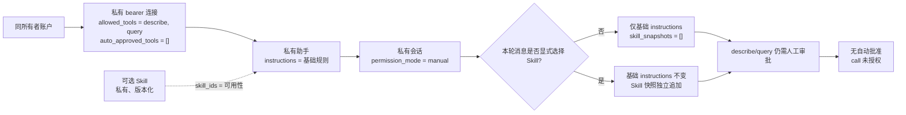

# 华微单入口账户交付：R3 组合预演（HW-037e）

> **核心判断：现有通用 Skill、助手 `instructions` 与同所有者私有连接绑定已经足以表达 R3 组合，不需要新增平台级“默认 Skill”功能；但本任务只交付离线合成测试与文档，没有访问或变更真实华微账户，也没有在真实部署上运行，因此端到端仍未验收。**

- 任务：HW-037e，固定基线 `4f59e7b687adc493b9f7dac676688b8e3e5ccd00`。
- 本任务只新增两个文件：`docs/huawi-parity/account-delivery.md`、`server/tests/test_huawi_account_bundle.py`。
- 未修改 `app/`、前端/UI、数据库结构、生产配置或任何真实账户。
- 本任务未运行 pytest；第 7 节给出独立执行命令与预期结果。第 1、8 节明确区分“已编码断言”和“已观测证据”。

## 1. 证据状态

| 项目 | 本任务状态 | 说明 |
|---|---|---|
| R3 组合可由现有 API 表达 | 已编码为合成断言，未执行 | 只使用 `app/skills.py`、助手创建/补丁模型、`service.py` 现有路径与 `test_api.py` fixture |
| 合成同所有者私有连接 describe/query | 已编码，未执行 | 连接、工具清单、审批结果全部是合成数据；不调用真实 MCP |
| 基础 instructions 不选 Skill 即生效 | 已编码，未执行 | 通过运行快照 `capability_snapshot.instructions` 与 `skill_snapshots=[]` 断言 |
| 可选 Skill 版本化、非自动 | 已编码，未执行 | 助手 `skill_ids` 只表示可用性；消息级 `skill_ids` 才产生本轮快照 |
| 跨所有者拒绝 | 已编码，未执行 | 私有连接、Skill、助手、会话对他人及管理员均不可见 |
| revision/回滚保护 | 已编码，未执行 | `expected_revision` 冲突、运行快照固定、连接 revision 固定、Skill 版本历史 |
| 真实华微账户访问/变更 | 本候选工人未进行；总控另行完成R3私有配置 | 无账号凭据、客户问题或答案进入合成测试 |
| 实时 MCP describe/query | 未进行 | 嵌套字段、过滤/分组/分页真实范围未重新验证 |
| 模型/运行时调用 | 未进行 | 测试使用 `FakeRuntime`，不调用模型供应商 |
| UI 验收 | 未进行 | 未修改、未打开真实工作台 |
| 部署版本确认 | 未完成 | 合同仅记录健康检查 HTTP 200 返回状态，未确认实际部署 commit |

**反例边界：** 测试代码存在、合成断言通过、健康检查返回 200、或通用 Skill 能导入，都不等于真实账户已交付。只有在本文件第 5 节的真实账户步骤执行并留下运行时快照后，才能讨论端到端。

## 2. 复用的现有能力（无新增平台功能）

| 现有能力 | 代码位置 | 在 R3 中的作用 | 本任务改动 |
|---|---|---|---|
| Skill 导入与版本快照 | `server/app/skills.py`：`import_skill`、`save_skill`、`skill_versions` 路由 | 把已提交的通用 `SKILL.md` 作为私有、版本化的可选规则 | 无 |
| 可用性与本轮选择分离 | `server/app/skills.py`：`assistant_skills`、`selected_skills` | 助手 `skill_ids` 仅是“可用”；消息 `skill_ids` 才进入本轮 `skill_snapshots` | 无 |
| 助手创建/补丁模型 | `server/app/models.py`：`AssistantCreate`、`AssistantPatch`、`SendMessage` | `instructions`、`skill_ids`、`expected_revision` 沿用现有字段 | 无 |
| 助手绑定校验 | `server/app/service.py`：`save_assistant` | 校验连接已发现工具、`auto_approved_tools ⊆ allowed_tools`、私有依赖范围 | 无 |
| 运行快照 | `server/app/service.py`：`_prepare_run`（保存 `capability_snapshot`、`skill_snapshots`、消息 `skills`） | 固定本轮 instructions、连接 revision、Skill 版本 | 无 |
| 运行时组合 | `server/app/service.py`：`runtime_config`；`server/app/harness_runtime.py`：`prompt_with_selected_skills` | 系统规则来自助手 `instructions`；本轮 Skill 作为独立提示段追加 | 无 |
| revision 保护 | `server/app/models.py`：`AssistantPatch.expected_revision`；`service.py` 的 `ASSISTANT_CONFLICT`、`CONFIG_CHANGED` | 阻止过期覆盖与连接变更后的静默执行 | 无 |
| 已提交通用 Skill | `examples/huawi-parity-readonly/SKILL.md` | 可选、声明式、`required_tools=[]`，不授予工具 | 无（只读取并导入到测试数据库） |
| 本地测试 fixture | `server/tests/test_api.py`：`client`、`configured`、`login`、`poll` | 复用现有 FastAPI 应用、临时数据库、`FakeRuntime` | 无 |

没有新增“平台默认 Skill”字段、默认执行策略或 UI 开关；R3 的“默认规则”直接使用助手已有的 `instructions`。

## 3. R3 组合关系



### 3.1 组合规则

1. **基础规则放在助手 `instructions`**：不依赖任何 Skill 选择即生效；本轮运行快照固定当时版本。
2. **可选 Skill 只做“可用性”**：助手 `skill_ids` 配置后，`GET /assistants/{id}/skills` 能看到它，但不会自动加入运行。
3. **本轮选择必须显式**：消息体 `skill_ids` 才会生成 `skill_snapshots`，并记录 `id/name/revision`；不选择时为空。
4. **不重复默认规则**：Skill 文本不写回 `capability_snapshot.instructions`；测试同时断言核心标记不出现在 Skill 正文中，避免同一规则在两处重复维护。
5. **权限不扩大**：连接只允许 `describe`、`query`；`auto_approved_tools=[]`，`authorize_tool` 返回 `False`（人工批准）；`call` 直接 `TOOL_DENIED`。
6. **无团队共享资源**：测试创建的全部是 `private`，跨所有者与管理员均不能读取或绑定。

## 4. 合成验证矩阵

所有用例只使用 `tmp_path` 数据库、合成 URL/占位凭据、合成工具 schema、已提交通用 Skill 和 `FakeRuntime`；不发起网络请求，不调用模型，不包含真实 ID、真实数据集或客户答案。

| 测试函数 | 关键断言 | 证据性质 |
|---|---|---|
| `test_same_owner_private_connection_is_manual_read_only_without_auto_approval` | 连接为 private、同 owner；工具为合成 `describe/query/call`，schema 为合同形状；绑定仅允许 `describe/query`、自动批准为空；会话默认 manual；`authorize_tool` 对 describe/query 返回 `False`，对 call 抛 `TOOL_DENIED` | 本地合成 API 断言 |
| `test_core_instructions_are_effective_and_optional_skill_is_never_implicit` | 未显式选择时运行 `skill_snapshots=[]` 且 `instructions=核心规则`；显式选择后快照含 Skill rev1，但 `instructions` 仍为核心规则；消息 `skills` 记录本轮选择；助手配置不被 Skill 改写 | 本地运行快照断言 |
| `test_skill_versions_and_revocation_guard_explicit_selection` | Skill rev2 后版本列表为 `[2,1]` 且 rev1 正文不变；已完成运行仍保留 rev1；停用后显式选择返回 `SKILL_UNAVAILABLE`，且不新增消息/运行 | 本地版本与撤销断言 |
| `test_cross_owner_private_bundle_is_denied` | 其他成员看不到、读不到、改不到、删不到私有连接/Skill/助手/会话；不能把他人 Skill 绑到新助手或使用他人助手建会话；管理员也不继承私有资源 | 本地跨所有者断言 |
| `test_assistant_and_connection_revisions_block_conflicts_and_pin_the_run` | `expected_revision` 过期返回 `ASSISTANT_CONFLICT`；已准备运行继续使用提交时的 instructions；连接 revision 变化后 `runtime_config` 抛 `CONFIG_CHANGED` | 本地 revision 快照断言 |

**未覆盖：** 真实 MCP 的嵌套字段与操作符、真实 group/filter/page 范围、真实模型回答、真实 UI、真实部署 commit、真实账户权限现状。

## 5. 最小真实账户步骤

前置条件：

- 部署版本包含本基线之后的通用 Skill 与现有组合实现；且不是受控试用模式（`require_trial_fields` 在试用模式下拒绝 Skills）。
- 使用现有已授权、同所有者私有的连接；不新增凭据、不扩大数据权限、不创建团队共享资源。
- 现有客户助手私有 rev5 的权限（describe/query/call allowed、auto 为空）保持不变。

### 5.1 已采用的最小风险路径（独立 R3 验收候选）

使用正常登录的同所有者私有账号，复用现有连接，创建独立 R3 助手。仅绑定 describe/query，自动批准为空；原客户业务助手与 R2 保持不变。通用基础规则写入助手默认 instructions，已审 Skill 作为可选资源绑定，不要求每轮显式选择。不得执行 call 或写入操作。

2026-11-28，真实账号已创建私有 Skill 与独立 R3；修正传输编码后均为 rev2，内容和所有权经回读核验。尚未执行真实 R3 问答，也未确认部署 commit；此配置不代表真实业务已验收。实际部署需要核对版本和测试环境边界；随后使用无显式 skill_ids 的新对话开展同题验收，保留原始回执和权限证据。

### 5.2 客户原入口推广（通过真实验收后）

先读取原助手当前 revision 和完整配置，确认原入口的实际工具权限与业务要求。不得把 R3 测试候选的仅只读权限等同于原入口的 describe/query/call 绑定；call 是否允许执行须另行确认，不能通过规则文本代替硬权限控制。先完成真实 R3 及对应功能验收，再通过正式 API 与 expected_revision 仅修改获准字段，保留回退快照、原助手 ID、访问范围与历史。未授权的动作和共享范围不得扩大。

### 5.3 部署与版本前提（未完成）

1. 实际部署 commit 必须包含已提交通用 Skill 与本节依赖的现有组合路径；健康检查 HTTP 200 只返回状态，不能证明 commit，必须从部署记录/制品单独核对。
2. 部署不能处于受控试用模式：`require_trial_fields` 在试用模式下拒绝 Skills。
3. 真实账户步骤执行前，先在目标部署上确认：通用 Skill 可 `import` 为私有、助手 `expected_revision` 生效、运行快照包含 `instructions` 与 `skill_snapshots`、describe/query 返回人工审批。
4. 任何一项不符合时停止真实账户步骤，先修部署/版本；不要在客户助手上试错。

## 6. 回滚与修订保护

| 变更 | 保护机制 | 行为 |
|---|---|---|
| 两人同时编辑助手 | `AssistantPatch.expected_revision` + 条件 UPDATE | 过期写入返回 `409 ASSISTANT_CONFLICT`，不覆盖新版本 |
| 任务提交后助手规则被编辑 | 运行快照 `capability_snapshot.instructions` | 已准备/执行中的任务继续使用提交时 instructions |
| 任务提交后连接被修改 | `connection_revisions` 固定 + `CONFIG_CHANGED` | 运行时拒绝，要求重新发送任务 |
| Skill 被编辑/停用 | 运行 `skill_snapshots` 固定版本；运行时重新校验 enabled 与助手 `skill_ids` | 已选版本可审计；停用或解绑后 `SKILL_UNAVAILABLE` |
| Skill 内容回退 | `/skills/{id}/versions` 保留每次快照 | 旧正文可取回；PATCH 回旧正文会产生新 revision，旧快照不变 |
| 助手规则回退 | 无助手版本表 | 必须先用 GET 留存正文；回滚 = 带当前 revision 的 PATCH |

## 7. 独立测试命令与预期

```bash
cd server
python -m pytest tests/test_huawi_account_bundle.py -q
```

预期：`5 passed`。测试不访问网络、不调用模型、不读取真实账户；`FakeRuntime` 只回显合成文本。若同时回归通用 Skill 候选：

```bash
python -m pytest tests/test_huawi_account_bundle.py tests/test_huawi_parity_skill_candidate.py -q
```

预期：上述 5 个用例加上既有候选用例全部通过。**本任务未执行这些命令，以上是待验证预期，不是已观测结果。**

## 8. 限制与剩余证据

1. **没有端到端证据**：未访问真实华微账户，未运行真实模型/MCP，未做 UI 操作，未部署。
2. **部署版本未确认**：合同记录的健康检查 HTTP 200 只返回状态；必须另行核对实际部署 commit 是否包含本基线与通用 Skill。
3. **真实数据契约未扩展**：合成 schema 只复述合同已观察到的顶层形状；嵌套字段、操作符、真实 group/filter/page 范围仍需单独证据。
4. **Skill 内容仍是候选**：`examples/huawi-parity-readonly/SKILL.md` 是受限通用规则候选，不是客户原文，也不声称与客户实现逐字等价。
5. **助手无版本表**：真实回滚必须先人工保存当前配置；不能把 `revision` 当作历史版本恢复机制。
6. **合成占位符**：测试中的 URL、bearer 占位凭据、用户名、问题均为合成值，不代表真实账户配置。

## 9. 变更文件

- `docs/huawi-parity/account-delivery.md`（本文件）
- `server/tests/test_huawi_account_bundle.py`（合成验收用例）

未修改任何 `app/`、前端、UI、生产配置或真实账户数据。
