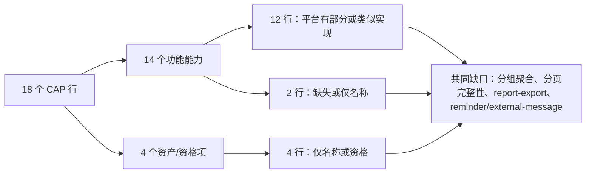

# 华微（HW-027a）资产与平台能力映射

**核心判断：18 个已知能力行中，平台对多数行有可核对代码或类似实现，但没有任何一行达到“完整等价 + 已验收”；CAP-017 报告导出依赖缺失，CAP-001 tmk-parity 与 CAP-002 domain-routing 只有名称，23 份 SKILL.md、18 个插件清单、43 个 eligible 技能均只有已知数量而非完整名单。** 本文件只做静态证据对照，不声称测试已执行、不访问客户/生产/网络。

- 任务：HW-027a，隔离分支 `feat/huawi-capability-inventory-20261128`，固定基线 `2c330bfd9a05bce9ca16b01ba46ba31af2c8da7a`。
- 输入：`docs/huawi-parity/capability-map-contract.md`（有界、已脱敏合同，不是客户导出）。
- 机器可读文件：[`capability-map.json`](capability-map.json)。
- 本任务未运行测试；第 8 节给出 lead 可独立执行的验证命令与断言。

## 1. 覆盖结论



| 结论 | 数量 | 说明 |
|---|---:|---|
| CAP 行总数 | 18 | CAP-001 至 CAP-018，与合同一致 |
| 功能能力 | 14 | CAP-001..005、010..018 |
| 资产/资格项 | 4 | CAP-006..009（技能/绑定/插件配置） |
| 部分实现（partial） | 9 | CAP-003/004/005/010/011/014/015/016/018；其中 CAP-016 仅发现、未授权执行 |
| 仅类似实现（analogue_only） | 7 | CAP-002/006/007/008/009/012/013 |
| 缺失（absent） | 1 | CAP-017 |
| 未知（unknown） | 1 | CAP-001 |
| 完整等价且已验收 | 0 | 无 |

> 上表按“覆盖状态”粗分，逐行精确状态见第 5 节；同一行可能同时是“部分实现”和“有资产名称”，不重复计数为客户能力。

## 2. 证据等级

| 等级 | 定义 | 本轮行数 |
|---|---|---:|
| A | 恢复原始制品：可核对的原文件路径与内容 | 0 |
| B | 有界合同事实 + 精确平台代码符号已检查 | 8 |
| C | 仅有界合同事实，平台仅有类似实现或无直接实现 | 3 |
| D | 仅名称或数量，路径/内容未恢复 | 7 |
| E | 无证据或未恢复 | 0 |

**反例边界：** 代码存在、函数可导入、文档写了合同，都不等于已运行或已生产验收。尤其不能把 `readOnlyHint`、自动批准、工具名或 `complete=true` 当作只读/完整性证明。

## 3. 资产清单（与功能分离）

已知数量不是完整列表。以下数量全部来自合同第 3 行；未恢复的名称一律留空，未补造。

| 资产 | 已知数量 | 完整名单 | 已知名称子集 | 等级 |
|---|---:|---|---|---|
| 导出的 SKILL.md | 23 | 否 | 无 | D |
| 原生 eligible 技能 | 43（含非业务） | 否 | 无 | D |
| 业务相关 eligible 条目 | 18 | 否 | `all-service-tool-binding`、`mes-tool-binding`、`system-manual-qa` | D |
| 其中 `xiaoguanbao-*` | 15 | 否 | 0 个全名恢复 | D |
| 插件配置/清单 | 18 | 否 | 无 | D |
| 缺失制品 | 2 | 否 | `portable-runtime.cjs`、`services/http-adapter/report-export.cjs` | D |

平台配置事实：原生统一 `hwmcp` 已启用，旧的分离域已停用（合同第 3 行）。这只说明历史配置，不代表本仓库运行配置或客户已启用任何能力。

## 4. 平台模块与能力的关系

```mermaid
flowchart TD
  MCP["MCP 业务工具层<br/>server/app/mcp_tools.py"] --> B1["结果预算/凭据清理<br/>enforce_model_result_budget"]
  MCP --> B2["工具发现与调用<br/>MCPBusinessTool.invoke"]
  RO["只读确认层<br/>read_only_tools.py"] --> B3["定义摘要/确认校验<br/>validate_confirmation"]
  CR["连接复核<br/>connection_read_review.py"] --> B4["通用/写入工具拒绝<br/>require_session_tool_eligible"]
  TR["可信只读合同<br/>trusted_mcp_read.py"] --> B5["身份绑定/去重复用<br/>connection_identity"]
  CP["能力策略<br/>capability_policy.py"] --> B6["域名 allowlist/交集<br/>domain_allows"]
  CE["能力执行器<br/>capability_execution.py"] --> B7["宿主身份/审批回执<br/>RunContext"]
  BR["业务结果投影<br/>business_results.py"] --> B8["business-result/v1<br/>project_business_result"]
  BF["业务事实核对<br/>business_facts.py"] --> B9["返回行小计<br/>verify_aggregates"]
  SK["技能<br/>skills.py"] --> A1["SKILL.md 导入（仅说明）<br/>import_skill"]
  PL["插件治理<br/>plugins.py / plugin_catalog.py"] --> A2["清单登记/离线目录<br/>register_plugin"]
```



## 5. 逐能力映射总表

状态：`partial`=部分实现，`analogue_only`=仅类似实现，`absent`=缺失，`unknown`=定义不足。每行的精确文件/符号与代码级说明见 `capability-map.json`。

| ID | 能力 | 类别 | 等级 | 平台实现（精确符号） | 覆盖缺口 | 下一独立测试 |
|---|---|---|---|---|---|---|
| CAP-001 | tmk-parity | 功能 | D | 未发现（`git log -S tmk` 待查） | 定义与原部分适配未恢复 | 本地 Git 历史检索，空则记录未发现 |
| CAP-002 | domain-routing | 功能 | D | `runtime.py:RESULT_FACT_KEYS`、`result_fact_metadata`（仅字段投影） | 无 domain→process→object→metric 路由器；网络域名≠业务域 | 检索 `business_domain`，确认只有投影 |
| CAP-003 | mcp-query-boundary | 功能 | B | `mcp_tools.py:enforce_model_result_budget`、`MCPBusinessTool.invoke`；`tool_constraints.py:validate_arguments`；`read_only_tools.py:validate_confirmation`；`connection_read_review.py:require_session_tool_eligible` | 无统一 describe/query/call 查询面；无 group_by/include_total 发布字段合同 | `pytest tests/test_harness_mcp_tools.py tests/test_capability_execution_security.py` |
| CAP-004 | query-completeness | 功能 | B | `business_results.py:project_business_result`、`MAX_ROWS`、`MAX_COLUMNS`、`oversized_only_reply`；`business_facts.py:verify_aggregates` | 无 grouped COUNT/DISTINCT 合同；无分页枚举证明 | `pytest tests/test_business_results.py tests/test_result_facts.py` |
| CAP-005 | response-contract | 功能 | B | `business_results.py:presentation_receipt`、`answer_fact_digest`；`business_facts.py:check_answer`、`conflict_answer`；`docs/business-result-contract.md` | canonical business-result/v1 未成主线；纯文本 SDK 回调不解析；分组响应未证 | `pytest tests/test_business_answer_contract.py tests/test_business_facts.py` |
| CAP-006 | MCP-direct type skill | 资产 | D | `skills.py:import_skill`、`create_skill_router`（仅说明） | SKILL.md 路径/内容未恢复，无法判定类型 | 检索 `SKILL.md` 中的 MCP 标记 |
| CAP-007 | all-service-tool-binding | 资产 | D | `mcp_tools.py:build_mcp_tools`；`plugins.py:register_plugin` | 绑定工具清单/权限/启用状态未恢复 | 精确名称检索，仅合同命中则保持 D |
| CAP-008 | mes-tool-binding | 资产 | D | `mcp_tools.py:build_mcp_tools`；`plugin_catalog.py:CATALOG_SNAPSHOT` | MES 绑定工具/版本/权限未恢复 | 精确名称检索，仅合同命中则保持 D |
| CAP-009 | system-manual-qa | 资产 | D | `skills.py:assistant_skills`、`selected_skills` | SKILL.md、知识来源、引用规则未恢复 | 精确名称检索，不推断客户手册 |
| CAP-010 | trusted channel/identity resolver | 功能 | B | `capability_execution.py:RunContext`、`_load`、`_authorize`；`trusted_mcp_read.py:connection_identity`、`trusted_read_decision`；`external_capabilities.py:ToolContext` | 无外部消息通道适配器；无独立 session identity resolver 注册表 | `pytest tests/test_capability_execution_security.py tests/test_capability_settings.py` |
| CAP-011 | proxy allowlist/dedup/describe compatibility | 功能 | B | `capability_policy.py:normalize_domain`、`domain_allows`、`intersect_domains`；`mcp_tools.py:include_structured_text`、`schema_validator`；`trusted_mcp_read.py:_reuse_decision`；`read_only_tools.py:_checked_digests` | 无正向代理；去重仅完全相同 JSON；describe 仅 schema 摘要/方言 | `pytest tests/test_harness_mcp_tools.py tests/test_business_results.py` |
| CAP-012 | identity/session metadata cache | 功能 | C | `read_only_tools.py:_checked_digests`；`tool_constraints.py:_compiled_schemas`；`mcp_availability.py:MCPAvailability` | 仅 schema/发现重试缓存；无身份/会话缓存 TTL 与撤权合同 | `pytest tests/test_harness_mcp_tools.py` |
| CAP-013 | batch metric completion/stop | 功能 | C | `runtime.py:interrupt`、`cancel`；`session_observability.py:TERMINAL` | 无 batch metric 提交/完成/停止协议 | 检索 `batch.*metric`，空则记录未发现 |
| CAP-014 | describe discovery/detail | 功能 | B | `mcp_tools.py:invoke`（list_tools 分页）；`read_only_tools.py:verify_live_definition`；`mcp_availability.py:refresh`；`business_data.py:tables` | 无统一 describe 工具；detail 仅 schema 与登记列名 | `pytest tests/test_harness_mcp_tools.py tests/test_business_results.py` |
| CAP-015 | query | 功能 | B | `mcp_tools.py:invoke`（call_tool）；`business_data.py:BusinessData`、`rows` | 无 group_by/include_total 执行器；远端范围投影不可独立证明 | `pytest tests/test_business_data.py tests/test_harness_mcp_tools.py` |
| CAP-016 | call discovery only | 功能 | B | `mcp_tools.py:MCPBusinessTool`；`harness_tools.py:HarnessToolBridge`、`active` | 调用代码存在但本工作未授权执行；只有发现证据 | 仅检索 `call_tool`，不发起网络调用 |
| CAP-017 | report-export dependency | 功能 | D | `conversation_export.py:create_conversation_export_router`（非等价） | 依赖缺失；实际导出能力/格式/权限未验证 | `find . -name 'report-export.cjs' -o -name 'portable-runtime.cjs'`，空则 absent |
| CAP-018 | write/reminder/external-message rules | 功能 | C | `high_risk_approval.py:HighRiskApprovalService`、`is_high_risk`、`requires_dual`；`openclaw_connector.py:_classify`、`request_approval`；`capability_policy.py:required_egress`；`model_approval.py:ModelApprovalService` | 有写入审批；无 reminder/external-message 规则、发送器或回执 | `pytest tests/test_high_risk_approval.py tests/test_capability_execution_security.py` |

## 6. 关键证据、反例与判断

### 6.1 查询边界与完整性（CAP-003/004/015）

- **已确认：** `server/app/mcp_tools.py:enforce_model_result_budget` 对模型可见结果执行 200 行/24 列与 32,000 UTF-8 字节硬边界；超限整包失败，错误码 `MCP_RESULT_TOO_LARGE`。
- **已确认：** `server/app/business_results.py:project_business_result` 保留 `returned_rows`、`total_rows`、`complete`、`truncated`、`warnings`；`total_rows < 返回行数` 或 `complete=true 且 total_rows > returned_rows` 时降为完整性未知。
- **反例：** 平台没有 `group_by`/`include_total` 的统一执行器；`COUNT`/`COUNT DISTINCT` 的分组聚合仍未按合同证明。不能因为没有失败就称为完整。
- **判断：** CAP-003/004/015 标为 `partial`。下一步必须补发布字段/操作清单与分组聚合合同，而不是只跑现有回归。

### 6.2 响应合同（CAP-005）

- **已确认：** `presentation_receipt` 生成 `business-result/v1` 显示回执；`answer_fact_digest` 把范围原值、返回行数、工具总行数/完整性、数据时点、合成标记与宿主已核小计作为有界摘录（>4,000 字节整体省略）。
- **已确认：** `business_facts.py:check_answer` 只核对单份结果、仍有权限来源的显式返回行合计；未覆盖文本保持 `not_checked`；冲突时 `conflict_answer` 保留原回答并标错。
- **反例：** 合同中的 canonical 后端 lead 候选尚未成为主线；纯文本 SDK 回调不解析为原始回执；宿主只收到一次实际结果。不能把“函数存在”写成“已合入/已上线”。

### 6.3 身份与 allowlist（CAP-010/011/012）

- **已确认：** `capability_execution.py:RunContext` 由宿主构造，模型参数不能提供 `user_id`；`_load` 每次重检 run/conversation/user/assistant 与 `active_run_id`。
- **已确认：** `trusted_mcp_read.py:connection_identity` 把可信只读合同绑定到精确账号、路由、凭据与 revision；`_reuse_decision` 仅在账号/作用域/URL/认证方式/工具定义/凭据完全一致时复用，不做名称或主机推断。
- **已确认：** `capability_policy.py:intersect_domains` 多策略取交集，结果永不比任一输入更宽。
- **反例：** 现有缓存只覆盖 schema 摘要、编译结果和 MCP 发现重试；没有 identity/session metadata cache 的 TTL、撤权失效或跨租户隔离合同。CAP-012 只能标 `analogue_only`。

### 6.4 发现、调用与导出（CAP-014/016/017）

- **已确认：** `MCPBusinessTool.invoke` 通过官方 `session.list_tools` 分页发现工具（最多 20 页/1,000 项），并比较远端 `inputSchema` 与已存定义；`verify_live_definition` 在执行前重新发现核对。
- **反例：** `call_tool` 执行入口存在，但本工作未获执行授权；不能把代码存在当作已执行。
- **缺失：** `portable-runtime.cjs` 与 `services/http-adapter/report-export.cjs` 未恢复；`conversation_export.py` 是会话导出，不是报表导出，不能替代 CAP-017 验收。

### 6.5 写入/提醒/外部消息（CAP-018）

- **已确认：** `HighRiskApprovalService` 提供高风险策略、请求快照与双人投票；`openclaw_connector._classify` 对写入/删除/管理/执行类工具提高风险；`capability_policy.required_egress` 把外发同意分为 deny/approval/allow。
- **反例：** 仓库内没有 reminder 或 external-message 的规则、发送器或回执。审批通过不等于消息已发送，也不等于客户已启用任何写入。

## 7. 恢复来源与缺失输入

### 7.1 恢复来源（只读，不访问客户/生产/网络）

| ID | 来源 | 可恢复内容 |
|---|---|---|
| RS-001 | 本工作树平台源码与测试 | 精确文件/符号与现有覆盖边界 |
| RS-002 | 本工作树架构与合同文档 | business-result/v1、能力执行器、开源复用边界 |
| RS-003 | 本仓库可达 Git 历史（仅本地） | tmk/domain-routing 等此前部分适配提交 |
| RS-004 | Lead 持有的原始导出归档（不在本工作树） | SKILL.md、插件清单、运行配置、缺失制品 |
| RS-005 | `docs/huawi-parity/capability-map-contract.md` | 名称、数量与已知事实；不是完整清单 |

### 7.2 缺失输入（不得补造）

| ID | 缺失输入 | 影响 |
|---|---|---|
| MI-001 | 完整原始导出 | 无法给出 23/18/43 的完整名单 |
| MI-002 | 运行配置、密钥、依赖、手册、业务数据 | 无法核对运行时行为、权限实际范围 |
| MI-003 | `portable-runtime.cjs` | 无法核对历史便携运行时 |
| MI-004 | `services/http-adapter/report-export.cjs` | CAP-017 无法验证 |
| MI-005 | 15 个 `xiaoguanbao-*` 全名 | 只能记录数量 15 |
| MI-006 | CAP-001/002 行为定义 | 只能按名称登记 |
| MI-007 | CAP-006 的 SKILL.md 路径/内容 | 无法判定 MCP-direct 类型 |
| MI-008 | 分组聚合与分页独立合同 | CAP-003/004/015 只能 partial |
| MI-009 | 纯文本 SDK 回调原始回执 | 不能解析为业务回执 |

## 8. 可复现验证命令

本任务**未执行**以下命令；由 lead 独立运行。所有临时目录放在 data3，未使用 `/tmp`、`/home` 或根目录。

### 8.1 结构校验

```bash
cd . && python3 -I - <<'PY'
import json
p = 'docs/huawi-parity/capability-map.json'
d = json.load(open(p, encoding='utf-8'))
ids = [r['id'] for r in d['capabilities']]
assert ids == [f'CAP-{i:03d}' for i in range(1, 19)], ids
assert len(ids) == len(set(ids)) == 18
assert all(r['category'] in {'functionality', 'asset'} for r in d['capabilities'])
assert all(r['source_evidence_grade'] in {'A', 'B', 'C', 'D', 'E'} for r in d['capabilities'])
required = {'id', 'name', 'category', 'source_evidence_grade', 'source_evidence',
            'platform_implementation', 'coverage_gap', 'evidence_needed', 'next_independent_test'}
assert all(required <= set(r) for r in d['capabilities'])
assets = [r['id'] for r in d['capabilities'] if r['category'] == 'asset']
assert d['classification']['asset_ids'] == assets
assert d['classification']['asset_count'] == len(assets) == 4
assert d['classification']['functionality_count'] == 14
assert d['inventory_completeness']['exported_skills']['known_count'] == 23
assert d['inventory_completeness']['runtime_eligible_skills']['known_count'] == 43
assert d['inventory_completeness']['runtime_eligible_skills']['business_related_count'] == 18
assert d['inventory_completeness']['runtime_eligible_skills']['xiaoguanbao_known_count'] == 15
assert d['inventory_completeness']['plugin_manifests']['known_count'] == 18
assert d['inventory_completeness']['exported_skills']['complete_list_recovered'] is False
assert d['inventory_completeness']['plugin_manifests']['complete_list_recovered'] is False
print('OK', len(ids), 'capabilities;', len(assets), 'assets')
PY
```

**期望：** `OK 18 capabilities; 4 assets`

### 8.2 引用完整性校验

```bash
cd . && python3 -I - <<'PY'
import json, pathlib
p = pathlib.Path('docs/huawi-parity/capability-map.json')
d = json.loads(p.read_text(encoding='utf-8'))
missing = []
for row in d['capabilities']:
    for impl in row['platform_implementation']:
        f = pathlib.Path(impl['file'])
        if not f.is_file():
            missing.append((row['id'], impl['file'], 'file'))
        elif impl.get('symbol') and impl['symbol'] not in f.read_text(encoding='utf-8'):
            missing.append((row['id'], impl['file'], impl['symbol']))
assert not missing, missing
print('OK refs', sum(len(r['platform_implementation']) for r in d['capabilities']))
PY
```

**期望：** `OK refs <n>`，`n` 为 `platform_implementation` 条目总数；任一文件或符号缺失即失败。

### 8.3 逐能力下一测试

第 5 节每行的“下一独立测试”给出具体测试文件与断言。建议顺序：

1. 先跑 CAP-003/004/005/010/011/014/015/016/018 的现有回归，确认静态引用未漂移。
2. 再对 CAP-002/012/013 做检索型验证，空结果按 `analogue_only` 记录。
3. 最后对 CAP-001/006/007/008/009/017 做恢复型验证；在 Lead 提供原始导出前不得升级证据等级。

所有 pytest 命令均使用 `-p no:cacheprovider` 与 data3 下的 `--basetemp`，不写 `/tmp` 或根分区。

## 9. 限制与交接

**限制**

- 本映射基于有界脱敏合同与本工作树源码，不是完整资产清单。
- 已知数量不等于完整列表；未恢复的名称/路径/内容一律留空，未补造。
- 平台实现状态仅按静态代码与文档核对；未运行测试、未访问客户/生产/网络、未读取 `.runtime`。
- 分组聚合、分页完整性、report-export 与 reminder/external-message 仍未证明。
- 资产条目的存在或资格不代表客户已启用，也不代表获得写入/外发权限。
- 未修改共享后端/运行时/审批行为，未提交或推送。

**交接给 lead**

1. 运行第 8 节两条校验命令，确认 JSON 结构与引用完整性。
2. 若 Lead 持有原始导出，优先恢复：23 份 SKILL.md 名单、18 个插件清单、15 个 `xiaoguanbao-*` 全名、CAP-001/002 定义、CAP-006 路径/内容、两个缺失 cjs。
3. 对 CAP-003/004/015 补发布字段/操作清单与分组聚合合同；对 CAP-005 确认 canonical business-result/v1 的合并状态；对 CAP-017 不要用会话导出替代。
4. 独立审阅时重点核对“代码存在但未执行/未上线”的反例，避免把静态实现写成已验收。

## 10. 变更文件

| 文件 | 变更 |
|---|---|
| `docs/huawi-parity/capability-map.md` | 新增：人类可读映射报告 |
| `docs/huawi-parity/capability-map.json` | 新增：18 行机器可读映射、资产/完整性、缺失输入、恢复来源、验证命令 |

未修改其他文件；未提交、未推送、未部署。
